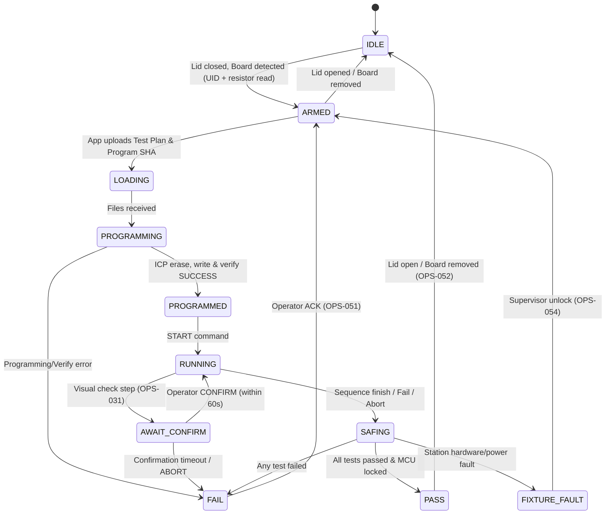

# ESP32-S3 Station Interface Specification

> **Target Audience:** Firmware Engineering Team implementing the physical ESP32-S3 FCT station.  
> **Status:** Final Contract (Aligned with `planner.md` Section 7 and `packages/contracts`).  
> **Reference Implementation:** `apps/station-sim` (Node.js/Fastify simulator passes the exact same test suite).

---

## 1. Overview & Network Protocol

The FCT Station hosts an HTTP 1.1 REST server and a WebSocket server on local Wi-Fi:
- Default Port: `4100` (or `80` in production)
- Data format: `application/json; charset=utf-8`
- Authentication: Bearer Token (`Authorization: Bearer <stationToken>`) returned by `/v1/pair`.
- mDNS Service: `_fct._tcp.local` broadcasting station ID and IP.

---

## 2. Station State Machine

The station operates under a strict finite state machine (FSM). State updates are emitted over WebSocket and reported in `/v1/info`.



### State Definitions
| State | Description | Actionable Buttons in App |
|---|---|---|
| `IDLE` | No board detected or fixture lid open | None |
| `ARMED` | Board present; UID and variant resistor read | **LOAD** |
| `LOADING` | Receiving JSON plan and program buffer | ABORT |
| `PROGRAMMING` | ICP erase, program flash, verify MCU | ABORT |
| `PROGRAMMED` | Verification succeeded; program buffer wiped from RAM; JSON kept | **START**, ABORT |
| `RUNNING` | Executing JSON test sequence | ABORT |
| `AWAIT_CONFIRM` | Waiting for operator visual check (e.g. LED display) — 60s timeout | **CONFIRM**, ABORT |
| `SAFING` | Power supplies disconnected, relays opened, lid unlocked | None |
| `PASS` | All sequence steps passed; MCU security lock bit set | Automatic next board |
| `FAIL` | A test step failed or verify failed | **ACK** (mandatory before retest) |
| `FIXTURE_FAULT` | Hardware fixture issue (pogo pin contact, supply rail overload) | Supervisor Unlock |

---

## 3. Memory & Security Rules (MANDATORY)

1. **RAM-Only Program Storage**: The firmware program file must **never** be saved to station flash (SPI flash) or SD card. It must reside strictly in volatile heap RAM.
2. **Immediate Buffer Zeroization**:
   - Immediately upon ICP verification (pass or fail), the program RAM buffer must be overwritten with zeroes (`memset(buf, 0, len)`).
   - Emit WebSocket event: `{"type": "wiped", "what": "program"}`.
3. **Session Termination Wipe**:
   - When the test completes (`PASS`, `FAIL`, `FIXTURE_FAULT`, or `ABORT`), the JSON test plan in RAM must be zeroed out.
   - Emit WebSocket event: `{"type": "wiped", "what": "plan"}`.
4. **Board Program Preservation**: Wiping station memory must **never** erase the target PCB's flashed microcontroller.

---

## 4. REST API Endpoints

### 4.1 `GET /v1/info`
No authentication required.
```json
{
  "stationId": "FCT-0007",
  "firmwareVersion": "1.0.0-esp32",
  "publicKey": "MCowBQYDK2VwAyEA...",
  "state": "IDLE"
}
```

### 4.2 `POST /v1/pair`
Exchange 6-digit dynamic pairing code displayed on the station TFT screen.
**Request:**
```json
{ "code": "849201" }
```
**Response (200 OK):**
```json
{ "stationToken": "st_ab79f041e892c4b8" }
```

### 4.3 `GET /v1/board`
Requires Bearer Auth.
```json
{
  "present": true,
  "boardUid": "4D53513100A1B2C3D4E5F601",
  "boardIdOhms": 1215.4
}
```

### 4.4 `POST /v1/sessions`
Start a testing session for the currently placed board.
**Request:**
```json
{ "confirmTimeoutMs": 60000 }
```
**Response (201 Created):**
```json
{ "sessionId": "sess_8102f92" }
```

### 4.5 `PUT /v1/sessions/:id/plan`
Upload JSON test plan. Station validates schema and variant resistance window (`boardIdOhms.min <= boardIdOhms <= boardIdOhms.max`).
**Response (200 OK):** `{ "ok": true }`

### 4.6 `PUT /v1/sessions/:id/program`
Upload target program file hash. Station performs ICP flashing:
1. Erase target MCU.
2. Flash target MCU.
3. Verify target MCU flash.
4. Wipe program RAM buffer.
5. Transition to `PROGRAMMED`.
**Response (200 OK):** `{ "ok": true, "state": "PROGRAMMED" }`

### 4.7 `POST /v1/sessions/:id/start`
Begin test sequence execution.
**Response (202 Accepted):** `{ "ok": true }`

### 4.8 `POST /v1/sessions/:id/confirm`
Operator visual confirmation for `CONFIRM` blocks.
**Response (200 OK):** `{ "ok": true }`

### 4.9 `POST /v1/sessions/:id/abort`
Immediately safe outputs and abort.
**Response (200 OK):** `{ "ok": true }`

### 4.10 `POST /v1/sessions/:id/ack`
Operator acknowledgement of `FAIL` state. Returns station to `ARMED` or `IDLE`.
**Response (200 OK):** `{ "ok": true }`

### 4.11 `GET /v1/records?afterSeq=N`
Retrieve signed test result records that have not yet been acknowledged.
**Response (200 OK):**
```json
[
  {
    "recordId": "550e8400-e29b-41d4-a716-446655440000",
    "stationId": "FCT-0007",
    "seq": 1042,
    "boardUid": "4D53513100A1B2C3D4E5F601",
    "serial": "WLC24090001",
    "variant": "WLC-ECO",
    "attemptNo": 1,
    "verdict": "PASS",
    "locked": true,
    "isGolden": false,
    "startedAt": "2026-09-23T10:41:07Z",
    "durationMs": 71240,
    "operatorId": "OP-12",
    "planVersion": "0.1.0",
    "planSha256": "...",
    "programSha256": "...",
    "steps": [
      {
        "id": "S010",
        "block": "LED_SCAN",
        "value": 1.72,
        "unit": "V",
        "min": 1.45,
        "max": 2.00,
        "verdict": "PASS",
        "ms": 40,
        "suspects": []
      }
    ],
    "signature": "ed25519:..."
  }
]
```

### 4.12 `POST /v1/records/ack`
App acknowledges sync to server; station can safely purge records from non-volatile flash.
**Request:**
```json
{ "recordIds": ["550e8400-e29b-41d4-a716-446655440000"] }
```

---

## 5. WebSocket Event Stream (`/v1/events?token=...`)

The station streams events in real-time to all paired clients:
- `{"type": "state", "state": "<StationState>"}`
- `{"type": "board", "board": {"present": bool, "boardUid": string, "boardIdOhms": number}}`
- `{"type": "uploadProgress", "sessionId": string, "percent": number}`
- `{"type": "programmingProgress", "sessionId": string, "percent": number}`
- `{"type": "wiped", "what": "program" | "plan"}`
- `{"type": "stepStart", "sessionId": string, "stepId": string, "block": string}`
- `{"type": "stepResult", "sessionId": string, "stepId": string, "value": number, "verdict": "PASS"|"FAIL"}`
- `{"type": "confirmRequest", "sessionId": string, "instruction": string, "timeoutMs": number}`
- `{"type": "completed", "sessionId": string, "verdict": "PASS"|"FAIL"|"FIXTURE_FAULT", "recordId": string}`
- `{"type": "error", "message": string}`

---

## 6. Digital Signature Specifications

1. **Algorithm:** Ed25519 (Edwards-curve Digital Signature Algorithm).
2. **Station Keypair:** Generated in secure element / flash on first boot. Public key registered in backend.
3. **Signing Procedure:**
   - Serialize canonical JSON of the result record omitting the `signature` field.
   - Compute Ed25519 signature over UTF-8 bytes.
   - Encode signature as base64 string prefixed with `ed25519:`.
